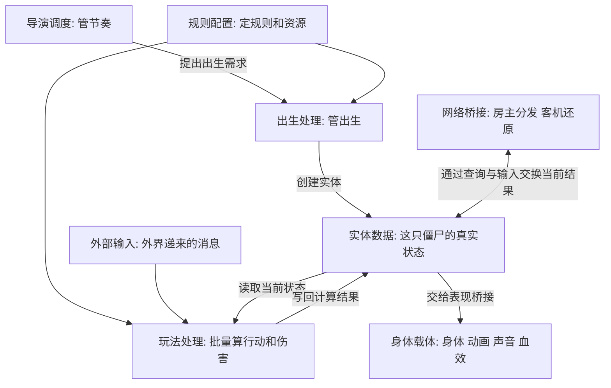
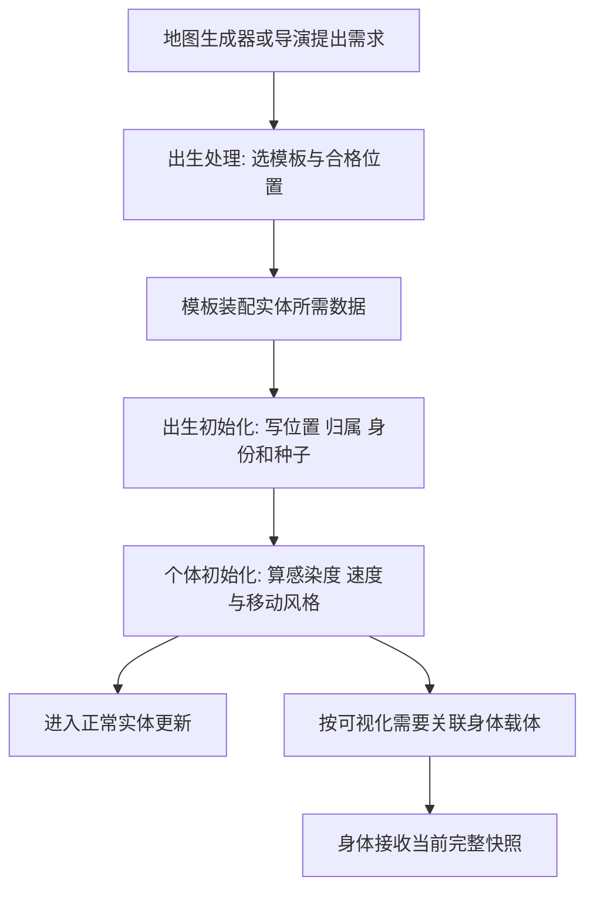

# 小怪 Law

僵尸的设计追求: 玩法处理决定伤成什么样和接下来做什么 身体负责把结果演出来

## 目录与中文名称

本目录为 `Mass/Instance/Monster/` 下文统一使用表中的中文名称

| 具体目录 | 中文名称 | 对应内容与功能 |
| --- | --- | --- |
| `Config/` | 规则配置 | 保存血量 速度 部位规则 出生规则以及模型 动画 伤口资源引用 |
| `Fragments/` | 实体数据 | 保存每只小怪当前的位置 行为 目标 伤害与伤口 |
| `Input/` | 外部输入 | 定义外界递给实体的消息及其检查和写入规则 |
| `Input/LocalControl/` | 本机输入 | 接收本机成立的命中 声音 生成与导演请求 |
| `Input/RemoteMessage/` | 远端消息 | 接收其它玩家发来的伤害贡献 |
| `Input/AuthorityFact/` | 房主结果 | 接收房主分发的行动与导演当前状态 |
| `Tags/` | 分类标记 | 标识小怪 导演和等待初始化的实体 |
| `Traits/` | 模板装配 | 创建实体时装齐需要的数据块 标记与配置初值 |
| `Processors/` | 玩法处理 | 由实体系统统一调度 各类处理器批量读取和更新实体数据 |
| `Processors/Spawn/` | 出生处理 | 选位置 创建实体 写入出生事实并计算个体差异 |
| `Processors/Director/` | 导演调度 | 维护阶段 节奏 数量与存活额度 并递交出生请求 |
| `Processors/Input/` | 输入解析 | 检查和消费输入 将有效结果写进实体数据 |
| `Processors/Perception/` | 感知处理 | 检查视野 声音和目标线索 |
| `Processors/Behavior/` | 行为决策 | 决定待机 警觉 巡逻 追逐 攻击或死亡 |
| `Processors/Movement/` | 寻路移动 | 计算路线 推进位置 转向 避让与处理地面 |
| `Processors/Collision/` | 部位碰撞 | 提供跟随身体姿势的逻辑命中区域 |
| `Processors/Combat/` | 攻击处理 | 推进攻击时机 检查命中条件并向玩家造伤 |
| `Processors/Health/` | 伤害生命 | 汇总部位贡献 推导血量与行动影响 并处理生命周期 |
| `Processors/HitReaction/` | 命中血效 | 推进最近命中的时效 并批量提交新命中血效 |
| `Processors/Presentation/` | 表现调度 | 更新动画事实 伤口集合 显示分级与身体表现 |
| `Processors/Network/` | 网络观察 | 读取当前结果并交给网络载体 |
| `Network/` | 网络桥接 | 定义传输数据和接收交接 连接房主与客机 |
| `Presentation/` | 身体表现 | 定义地图入口 身体载体 动画桥接 受击 伤口 声音与共享表现池 |

- 实体系统指统一管理实体身份 数据和批量调度的公共系统 公共服务位于 `Mass/Core/`
- 公共网络载体位于 `Mass/Network/` 本目录的网络桥接负责小怪自己的传输语义
- 导演和生成器的地图入口归身体表现目录 调度与出生计算归对应玩法处理目录
- 动画基类负责复制事实 动画蓝图负责选择和混合动作 动画蓝图与资源归引擎资产目录
- 局部受击组件负责骨骼受力 伤口组件负责伤口 血肉和缺肢 共享表现池负责血液 声音与残肢的集中管理

## 架构由什么组成

- 这几部分围绕同一个实体分工 每只僵尸自己的数据由实体系统持有
- 配置给规则 处理器给结果 身体给表现 网络负责把当前结果送到各端
- 外界通过输入投递入口 递消息 感知 寻路和移动处理器主动查询环境
- 僵尸遵循公共实体系统 网络 玩法 数据 动画与注释宪法

## 初始化怎么配合

- 模板装配负责把必需数据装齐 初始化处理器负责给这一代实体填好出生值
- 出生随机数按独立通道计算 各端用同一配置和种子还原个体差异
- 实体完成初始化后进入正常玩法和可视化处理 表现对象接收它此刻的位置 行为 伤势与动作进度

## 运行时怎么配合

| 环节 | 读取什么 | 交给下一环什么 |
| --- | --- | --- |
| 输入解析 | 命中 声音 网络结果等输入 | 当前有效数据 |
| 感知与行为 | 环境 目标 血量和行动能力 | 追谁 做什么 |
| 寻路与移动 | 目标 路线 地面和邻居 | 位置 速度和朝向 |
| 攻击与伤害 | 动作时机 命中贡献和部位规则 | 玩家受伤 僵尸伤势和行动影响 |
| 表现与网络 | 当前实体事实 | 画面表现与对端快照 |

- 表中说明业务交接 各处理器的实际执行顺序由实体系统阶段和依赖确定
- 每帧以当前有效数据推进 同一状态由对应职责维护

## 身体怎么挂接

- 实体可视化按显示需要为实体关联身体载体 身体模型挂在这个身体载体 上
- 表现处理器读取实体快照 更新身体位置 朝向与表现组件 客机显示位置和朝向使用平滑结果
- 动画基类复制行为 速度 命中 踉跄 爬行和动作进度 动画蓝图据此选择动作与混合
- 局部受击组件消费新命中驱动局部受力 伤口组件消费当前伤口与损毁结果 血效和声音消费各自的新鲜事实
- 身体再次关联实体时按当前快照恢复外观 对象复用时清理上一代受击 伤口 声音和尸体状态
- 逻辑命中使用部位形状 有可用身体姿势时参考当前骨骼 其余情况使用逻辑预设

## 挂掉以后怎么配合

- 各端根据贡献字典和配置独立判断死亡 死亡状态保持到这一代实体回收
- 尸体按配置保留 物理残肢 血迹和声音按各自共享池生命周期管理

## 生成与行动

- 导演管节奏 决定阶段 时机 数量与存活额度
- 生成器管出生 决定模板 出生区域和选点条件 普通生成与导演申请共用一套处理
- 出生配置管模板权重 选点预算 安全距离 间距 种子与朝向
- 个体差异配置管感染度 跑尸概率 速度偏差 警觉偏差和移动风格
- 房主创建僵尸并提供出生种子 各端用同一配置与种子还原个体差异 网络身份单独维护
- 房主负责选目标 寻路 移动与攻击 客机还原当前结果并平滑显示
- 感知负责发现玩家 行为负责决定待机 警觉 巡逻 追逐 攻击或死亡
- 寻路负责找路线 移动负责沿路线前进 转向 避让和处理地面
- 攻击处理器按前摇与恢复推进动作 在命中时刻检查距离 方向与遮挡 再向玩家提交伤害

## 打中哪里怎么算

- 头 躯干 左臂 右臂 左腿 右腿各有一份部位生命规则
- 部位命中区域带有自己的部位编号 有身体姿势时按骨骼摆放 其余情况使用逻辑形状
- 子弹沿飞行路线检查命中区域 取得目标 部位 接触点 方向与法线
- 命中结果分别交给伤害链和受击表现链 造伤权限由发射来源决定

## 伤害怎么记

- 每只僵尸保存一份当前伤害贡献字典 按稳定玩家身份记录六个部位的累计有效伤害
- 每个玩家只增加自己的贡献 各部位累计值随有效命中增加
- 部位规则提供生命比例 耐久比例 整体伤害传导比例 致死属性和损毁后的行动影响
- 同一代僵尸各端使用相同部位规则
- 单次有效伤害 = 普通伤害 × (1 - 耐久比例) + 耐久伤害 × 耐久比例 再应用当前伤害修正
- 部位生命 = 整体生命上限 × 部位生命比例 - 该部位全部玩家累计伤害 最低为零
- 整体生命 = 整体生命上限 - 各部位累计伤害乘对应传导比例的总和 最低为零
- 血量 部位损毁与行动失能都是贡献字典和配置推导出的当前缓存 伤害事实以贡献字典为准
- 同一轮多个命中先合并已有贡献和待处理贡献 再提交完整快照
- 同一玩家同一部位的贡献逐项取最大值 各玩家的记录分别保留 主客机使用同一合并规则
- 客机在自己的贡献增加时上报 房主合并并在字典变化时分发 晚加入时还原完整当前贡献
- 同一颗弹丸或同次爆炸对同一目标按确定的部位分配规则计入一次有效结果

## 受击怎么表现

- 最近命中只记录当前部位 接触点 方向 法线 时间与编号 伤害以累计贡献为准
- 局部受击读取新命中事实 对对应骨骼施加短时受力 并混回原动画
- 玩法处理判断踉跄 减速 断肢 爬行和死亡 动画基类把当前事实交给动画蓝图
- 动画蓝图负责选动作和过渡 动作进度与攻击命中时刻由玩法处理维护
- 伤口组件读取命中与损毁结果 维护固定容量的当前伤口集合 并还原伤口 血肉和缺肢
- 喷血 声音与残肢消费新鲜事实 同一命中按各自消费编号处理一次
- 身体重新出现时还原当前伤势 迟到的瞬间表现按时效处理
- 动画 伤口 血效与物理残肢按距离 可见性 显示精细度 和共享预算分级处理

## 死亡与回收

- 各端从本机贡献字典计算死亡 整体生命归零或致死部位损毁时立即进入死亡
- 死亡状态立即结束本机行动与交互 后续消息按当前死亡状态处理
- 非致死部位按配置产生行动影响 断臂影响攻击 断腿转入爬行
- 尸体按配置保留 回收前完成伤害消息可靠交接 表现对象复用时清理上一代状态
