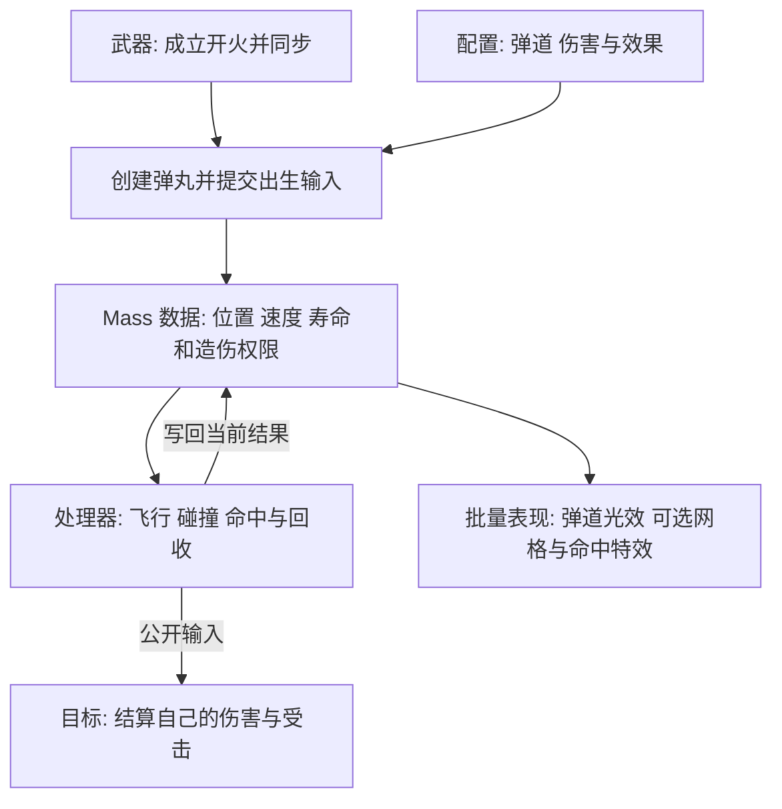
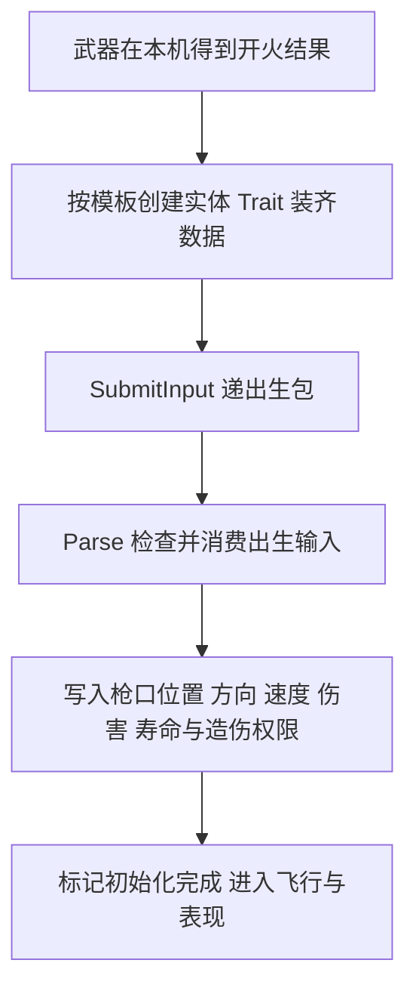

# Projectile Law

子弹的设计追求: 本机算自己的命中 远端还原开火和效果 伤害沿目标的公开入口结算

## 架构由什么组成

| 组成 | 管什么 | 对应实现 |
| --- | --- | --- |
| 武器与配置 | 发射来源 枪口方向 初速度 伤害和效果 | 武器开火入口与 Projectile Definition |
| Trait | 装齐子弹需要的位置 速度和业务数据 | BBBProjectileTrait |
| 输入与初始化 | 把这次发射参数写进实体 | Spawn 输入包与 ParseProcessor |
| 当前数据 | 上一位置 当前速度 伤害 穿透额度 寿命和造伤权限 | Fragments |
| 运行处理器 | 推进飞行 找命中目标 处理穿透反弹和寿命 | Movement Collision Lifetime |
| 表现桥接 | 批量显示飞行与命中结果 | PresentationProcessor 与共享表现资源 |

- 子弹按弹丸实体管理 画面按批量表现资源管理
- 开火同步由武器承担 各端的弹丸按自己的枪口和当前配置初始化
- 子弹遵循公共 Mass 网络 玩法 数据与注释宪法

## 初始化怎么配合

- 出生包携带本次发射的确定参数 Parse 在帧末消费武器提交的出生事实
- 初始化把发射参数写入同一实体的运动 碰撞 寿命和表现数据
- 发射来源的本机控制权决定造伤权限 本机控制弹丸贡献伤害 镜像弹丸还原效果

## 运行时怎么配合

- 目标负责解释自己受到的伤害 子弹通过公开查询和输入完成交接
- 同一轮命中先合并到当前贡献快照 再提交目标的输入槽位
- 实际运行顺序由 Parse Movement Collision Presentation Lifetime 的阶段依赖组织

## 表现怎么挂接与结束

- 表现处理器将活动弹丸的位置和当前效果参数交给批量光效 可选网格按共享实例槽位显示
- 玩法碰撞读取逻辑弹道 画面读取同一实体的位置和命中结果
- 命中结束时先提交本次交接与表现 再由寿命处理器安全回收实体
- 表现槽位和已发出的特效按各自生命周期释放 实体身份随本次弹丸结束
- 各端从已同步的开火结果生成本地弹丸 网络承载的是武器开火语义

## 飞行与命中

- 移动处理器保存上一位置 按速度 重力和本次有效时间推进当前位置
- 碰撞处理器检查这一段飞行路线 结合子弹半径取得最先接触的有效目标
- 命中结果包含目标 部位 接触点 飞行方向与表面法线
- 普通伤害 耐久伤害 踉跄值与伤口表现参数各按自己的职责使用
- 穿透 反弹 衰减和寿命按配置更新 当前数据记录必要的最近命中与剩余额度
- 同次开火用稳定攻击身份关联弹丸 每颗弹丸按命中与穿透规则贡献伤害

## 谁能造成伤害

- 发射来源在本机控制时 本机弹丸产生玩法伤害 其它机器上的对应弹丸负责镜像表现
- 命中僵尸时通过公开查询取得部位规则 计算有效伤害 再经 SubmitInput 提交累计贡献快照
- 同一轮对同一目标的贡献在提交前合并 受击方向与接触信息通过对应表现输入递交
- 子弹的网络语义由武器开火同步承载 飞行与碰撞在各端按当前本地弹丸运行
- 子弹可见效果与玩法碰撞分工 表现使用批量光效 命中判定使用逻辑弹道

## 爆炸与投掷物边界

- Mass 弹丸的爆炸按目标和部位规则分配本次伤害 爆炸造伤权限沿用发射来源
- 消耗品释放后的物理投掷物归 Item/Consumable/Projectile 使用独立房主权威 Actor 与 UE 物理同步
- 消耗品投掷物由房主判定爆炸结果 投掷者一次性记入自己的累计部位贡献 再沿已有伤害链同步
- 飞行碰撞与爆炸分别配置对发射者的影响 手雷按配置影响自己与队友
- 弹丸寿命结束或命中流程完成后 通过 Mass 安全时机回收
