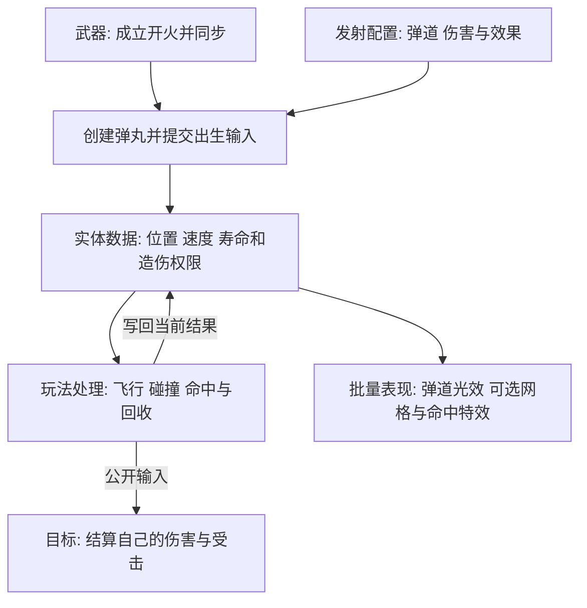
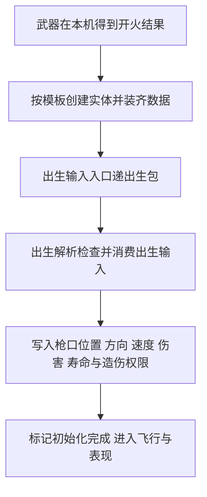
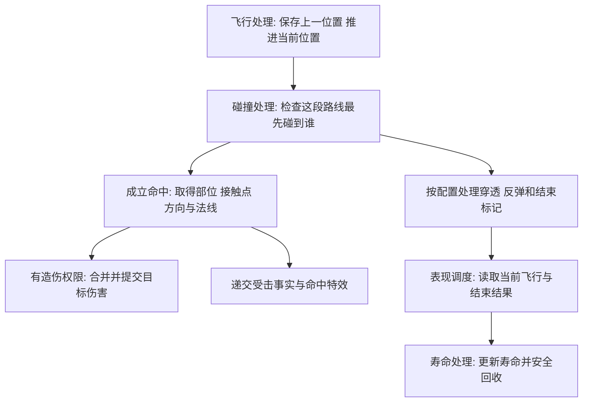

# 子弹 Law

子弹的设计追求: 本机算自己的命中 远端还原开火和效果 伤害沿目标的公开入口结算

## 物理文件构造

本目录为 `Mass/Instance/Projectile/` 按下面的目录层级组织 右侧先列中文名称 再说明功能 后文沿用这些名称

```text
Projectile/
    Config/                                                     发射配置 定义弹道 伤害 穿透 反弹 寿命与效果资源
        BBBProjectileDefinition.h / .cpp                        发射规则 弹道 伤害与效果参数
    Fragments/                                                  实体数据 保存每颗弹丸自己的当前数据
        Spawn/                                                  出生输入槽 保存等待处理的本次发射参数
        Movement/                                               运动数据 保存上一位置 初始化状态和运动参数
        Collision/                                              碰撞数据 保存当前伤害 造伤权限 穿透额度和最近命中目标
        Lifetime/                                               寿命数据 保存剩余时间 引信和结束标记
        Presentation/                                           表现数据 保存当前弹丸使用的效果资源与表现槽位
    Input/                                                      外部输入 按来源和领域组织弹丸输入消息
        LocalControl/                                           本机输入 保存本机发射产生的输入定义
            Spawn/                                              出生输入 定义武器提交给弹丸的发射消息
    Tags/                                                       分类标记 标识弹丸实体类别
    Traits/                                                     模板装配 创建实体时装齐位置 速度和弹丸业务数据
        BBBProjectileTrait.h / .cpp                             弹丸模板装配
    Processors/                                                 玩法处理 批量执行出生 飞行 碰撞和回收逻辑
        Spawn/                                                  出生解析 检查出生输入并完成本次发射初始化
        Movement/                                               飞行处理 保存上一位置并按速度和重力推进当前位置
        Collision/                                              碰撞处理 查询命中 递交伤害与受击结果 并处理穿透反弹
        Presentation/                                           表现调度 读取当前飞行和命中结果 管理共享表现槽位
        Lifetime/                                               寿命处理 推进剩余时间并安全回收结束的弹丸
    Presentation/                                               弹丸表现 定义批量飞行与命中表现的资源结构和引擎桥接
        BBBProjectilePresentation.h / .cpp                      弹丸表现 批量效果数据与引擎桥接
```

- 实体系统指统一管理实体身份 数据和批量调度的公共系统 公共服务位于 `Mass/Core/`
- 武器指成立开火并提交出生输入的发射方 武器实现归 `Item/Equipment/`
- 玩法处理是出生解析 飞行处理 碰撞处理和寿命处理的总称
- 批量表现由表现调度和弹丸表现共同完成 光效与可选网格使用共享资源和槽位
- 开火网络同步由武器负责 弹丸接收本次发射参数后在本机运行

## 架构由什么组成



- 子弹按弹丸实体管理 画面按批量表现资源管理
- 开火同步由武器承担 各端的弹丸按自己的枪口和当前配置初始化
- 子弹遵循公共实体系统 网络 玩法 数据与注释宪法

## 初始化怎么配合



- 出生包携带本次发射的确定参数 出生解析在帧末消费武器提交的出生事实
- 初始化把发射参数写入同一实体的运动 碰撞 寿命和表现数据
- 发射来源的本机控制权决定造伤权限 本机控制弹丸贡献伤害 镜像弹丸还原效果

## 运行时怎么配合



- 目标负责解释自己受到的伤害 子弹通过公开查询和输入完成交接
- 同一轮命中先合并到当前贡献快照 再提交目标的输入槽位
- 实际运行顺序由 出生解析 飞行处理 碰撞处理 表现调度 寿命处理 的阶段依赖组织

## 表现怎么挂接与结束

- 表现处理器将活动弹丸的位置和当前效果参数交给批量光效 可选网格按共享实例槽位显示
- 玩法碰撞读取逻辑弹道 画面读取同一实体的位置和命中结果
- 命中结束时先提交本次交接与表现 再由寿命处理器安全回收实体
- 表现槽位和已发出的特效按各自生命周期释放 实体身份随本次弹丸结束
- 各端从已同步的开火结果生成本地弹丸 网络承载的是武器开火语义

## 飞行与命中

- 移动处理器保存上一位置 按速度 重力和本次有效时间推进当前位置
- 碰撞处理器检查这一段飞行路线 结合子弹半径取得最先接触的有效目标
- 命中结果包含目标 部位 接触点 飞行方向与表面法线
- 普通伤害 耐久伤害 踉跄值与伤口表现参数各按自己的职责使用
- 穿透 反弹 衰减和寿命按配置更新 当前数据记录必要的最近命中与剩余额度
- 同次开火用稳定攻击身份关联弹丸 每颗弹丸按命中与穿透规则贡献伤害

## 谁能造成伤害

- 发射来源在本机控制时 本机弹丸产生玩法伤害 其它机器上的对应弹丸负责镜像表现
- 命中僵尸时通过公开查询取得部位规则 计算有效伤害 再经输入投递入口 提交累计贡献快照
- 同一轮对同一目标的贡献在提交前合并 受击方向与接触信息通过对应表现输入递交
- 子弹的网络语义由武器开火同步承载 飞行与碰撞在各端按当前本地弹丸运行
- 子弹可见效果与玩法碰撞分工 表现使用批量光效 命中判定使用逻辑弹道

## 爆炸与投掷物边界

- 实体弹丸的爆炸按目标和部位规则分配本次伤害 爆炸造伤权限沿用发射来源
- 消耗品释放后的物理投掷物归 `Item/Consumable/Projectile/` 使用独立房主权威物理载体与引擎物理同步
- 消耗品投掷物由房主判定爆炸结果 投掷者一次性记入自己的累计部位贡献 再沿已有伤害链同步
- 飞行碰撞与爆炸分别配置对发射者的影响 手雷按配置影响自己与队友
- 弹丸寿命结束或命中流程完成后 通过实体系统安全时机回收
